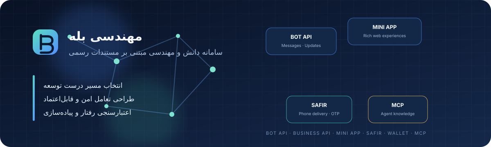

<a href="README.md">English</a> · <strong>فارسی</strong>

<h1>مهندسی بله | Bale Engineering</h1>

<strong>سامانه دانش و مهندسی برای ساخت ربات‌ها، مینی‌اپ‌ها و یکپارچه‌سازی‌های قابل‌اعتماد روی بله</strong>

<strong>Bale Engineering</strong> فقط مجموعه‌ای از توضیحات API نیست؛ یک سیستم مهندسی مبتنی بر مستندات رسمی است که به توسعه‌دهنده و Agent کمک می‌کند مسیر درست را انتخاب کند، معماری را طراحی کند، محدودیت‌ها و مرزهای امنیتی را بشناسد و پیاده‌سازی را با تست و شواهد بررسی کند.

<a href="README.md">نسخه انگلیسی</a> · <a href="docs/architecture.fa.md">معماری پروژه</a> · <a href="packages/mcp-server/README.fa.md">راهنمای MCP</a> · <a href="adapters/README.fa.md">نصب در Agentها</a>

<h2>در یک نگاه</h2>

<table>
<thead><tr><th>بخش</th><th>کاربرد</th></tr></thead>
<tbody>
<tr><td>Skills</td><td>دستورالعمل‌های تخصصی برای Agentها</td></tr>
<tr><td>Knowledge</td><td>مرجع فنی، محدودیت‌ها، مثال‌ها و خطاهای شناخته‌شده</td></tr>
<tr><td>MCP Server</td><td>دسترسی استاندارد و فقط‌خواندنی به دانش پروژه</td></tr>
<tr><td>Templates</td><td>قالب PRD، تصمیم معماری، قرارداد API و ماتریس تست</td></tr>
<tr><td>Diagrams &amp; Visuals</td><td>نمودارهای Mermaid و تصاویر SVG دوزبانه</td></tr>
</tbody>
</table>

<h2>چرا این پروژه؟</h2>
<ul>
<li>بله بر پایه Bot API تلگرام است، اما با آن یکسان نیست؛ پشتیبانی هر متد و پارامتر باید در مستندات خود بله بررسی شود.</li>
<li>Bot API، Business API، Mini App و Safir کاربرد و هویت گیرنده متفاوتی دارند.</li>
<li>مستندات رسمی از توصیه‌های مهندسی و موارد نامشخص تفکیک می‌شوند.</li>
<li>امنیت، کنترل دسترسی، Idempotency، مدیریت خطا و تست بخشی از طراحی هستند؛ نه کارهای انتهای پروژه.</li>
<li>MCP این دانش را در اختیار Agent قرار می‌دهد، اما به API عملیاتی بله وصل نمی‌شود و هیچ پیام واقعی ارسال نمی‌کند.</li>
</ul>

<h2>قابلیت‌های پوشش‌داده‌شده</h2>

<table dir="rtl">
<thead><tr><th>قابلیت</th><th>برای چه کاری؟</th></tr></thead>
<tbody>
<tr><td>Bot API</td><td>ربات، پیام، Update، Webhook، Polling، Keyboard و Callback</td></tr>
<tr><td>Business API</td><td>اعلان به گفت‌وگوی خصوصی موجود در بله</td></tr>
<tr><td>Mini App</td><td>فرم، داشبورد، فهرست و تجربه وب داخل بله</td></tr>
<tr><td>Safir</td><td>ارسال پیام به شماره تلفن، OTP و Template</td></tr>
<tr><td>Wallet Payments</td><td>فاکتور، پیش‌بررسی پرداخت و تأیید تراکنش</td></tr>
<tr><td>Deep Links</td><td>لینک ربات، پیام، دعوت و Mini App</td></tr>
<tr><td>Message Formatting</td><td>قالب‌بندی اختصاصی پیام‌های بله</td></tr>
</tbody>
</table>

<h2>نمودار انتخاب سرویس</h2>

~~~mermaid
flowchart TD
    U["نیاز کاربر"] --> Q{"نوع تعامل چیست؟"}
    Q -->|"گفت‌وگوی ربات"| BOT["Bot API"]
    Q -->|"رابط وب و فرم"| MINI["Mini App"]
    Q -->|"اعلان به چت خصوصی موجود"| BIZ["Business API"]
    Q -->|"ارسال به شماره تلفن / OTP"| SAFIR["Safir"]
    Q -->|"پرداخت کیف پول"| PAY["Bot API Invoice یا Mini App Invoice"]
    BOT --> CORE["Backend و منطق کسب‌وکار"]
    MINI --> CORE
    BIZ --> CORE
    SAFIR --> CORE
    PAY --> CORE
    CORE --> DB[("داده و وضعیت تحت مالکیت برنامه")]
~~~

<h2>نصب Skill اصلی</h2>

برای استفاده از دانش پروژه در Agentهای پشتیبانی‌شده:

~~~bash
npx skills add shahinesi/Bale-Engineering --skill bale-engineering
~~~

نصب Skillهای تخصصی:

~~~bash
npx skills add shahinesi/Bale-Engineering --skill bale-bot-api
npx skills add shahinesi/Bale-Engineering --skill bale-business-api
npx skills add shahinesi/Bale-Engineering --skill bale-miniapp
npx skills add shahinesi/Bale-Engineering --skill bale-safir
npx skills add shahinesi/Bale-Engineering --skill bale-wallet-payments
~~~

<h2>اجرای MCP Server</h2>

پیش‌نیاز: Node.js نسخه ۲۰ یا بالاتر و pnpm.

~~~bash
pnpm install
pnpm --filter @bale-engineering/mcp-server build
node packages/mcp-server/dist/index.js
~~~

این نسخه از ارتباط STDIO استفاده می‌کند و برای اجرا به‌صورت محلی در Codex، Claude Code یا Cursor طراحی شده است.

<a href="packages/mcp-server/README.fa.md">راهنمای کامل نصب و اتصال MCP</a>

<h2>ابزارهای MCP</h2>

<table dir="rtl">
<thead><tr><th>ابزار</th><th>عملکرد</th></tr></thead>
<tbody>
<tr><td><code>bale_list_skills</code></td><td>فهرست Skillها</td></tr>
<tr><td><code>bale_get_skill</code></td><td>دریافت متن کامل یک Skill</td></tr>
<tr><td><code>bale_get_reference</code></td><td>دریافت یک مرجع فنی</td></tr>
<tr><td><code>bale_search_knowledge</code></td><td>جست‌وجوی کلیدواژه‌ای در دانش</td></tr>
<tr><td><code>bale_route_task</code></td><td>پیشنهاد Skill بر اساس کلیدواژه</td></tr>
<tr><td><code>bale_validate_inline_keyboard</code></td><td>اعتبارسنجی Inline Keyboard</td></tr>
<tr><td><code>bale_validate_safir_payload</code></td><td>اعتبارسنجی Payload سفیر</td></tr>
<tr><td><code>bale_validate_business_api_request</code></td><td>اعتبارسنجی درخواست Business API</td></tr>
</tbody>
</table>

<h2>نمودارها و مستندات تصویری</h2>

نمودارها با Mermaid نگهداری می‌شوند تا قابل‌ویرایش و قابل‌بررسی در Git باشند. GitHub فایل‌های Markdown حاوی Mermaid و فایل‌های <code>.mmd</code> را به نمودار تبدیل می‌کند.

<ul>
<li><a href="docs/architecture.fa.md">معماری به زبان فارسی</a></li>
<li><a href="docs/architecture.md">Architecture in English</a></li>
<li><a href="docs/diagrams/platform-selection.fa.mmd">انتخاب API مناسب</a></li>
<li><a href="docs/diagrams/bot-update-lifecycle.fa.mmd">چرخه دریافت Update</a></li>
<li><a href="docs/diagrams/miniapp-authentication.fa.mmd">اعتبارسنجی هویت Mini App</a></li>
<li><a href="docs/diagrams/wallet-payment-lifecycle.fa.mmd">چرخه پرداخت کیف پول</a></li>
<li><a href="docs/diagrams/mcp-architecture.fa.mmd">معماری MCP</a></li>
<li><a href="docs/diagrams/business-api-notification.fa.mmd">ارسال اعلان با Business API</a></li>
<li><a href="docs/diagrams/safir-delivery-lifecycle.fa.mmd">چرخه ارسال سفیر</a></li>
<li><a href="docs/diagrams/callback-authorization.fa.mmd">اعتبارسنجی Callback</a></li>
<li><a href="docs/diagrams/deep-link-entrypoints.fa.mmd">مسیرهای Deep Link</a></li>
</ul>
<h2>ساختار مخزن</h2>

~~~text
skills/                  مهارت‌های Agent
knowledge/               دانش فنی و مستندات مرجع
packages/mcp-server/     سرور MCP فقط‌خواندنی
templates/               قالب‌های مهندسی
adapters/                راهنمای اتصال به Agentها
docs/                    معماری و نمودارهای دوزبانه
assets/                  تصاویر و هویت بصری پروژه
sources.json             منابع رسمی و مراجع فنی
AGENTS.md                قواعد نگهداری و مشارکت
~~~

<h2>مرزهای امنیتی</h2>
<ul>
<li>این MCP هیچ پیام واقعی ارسال نمی‌کند و هیچ Bot یا حسابی را تغییر نمی‌دهد.</li>
<li>توکن Bot و کلید Safir نباید در کد، Prompt، لاگ یا ورودی MCP قرار بگیرند.</li>
<li>اطلاعات Mini App فقط پس از اعتبارسنجی سمت سرور قابل‌اعتماد هستند.</li>
<li>Callback و وضعیت دکمه جایگزین مجوزدهی سمت سرور نیستند.</li>
<li>تأیید اولیه پرداخت به معنی موفقیت پرداخت نیست؛ تکمیل سفارش باید بعد از تأیید تراکنش انجام شود.</li>
<li>نمودارهای معماری این مخزن، الگوی پیشنهادی هستند و اسکرین‌شات محصول عملیاتی محسوب نمی‌شوند.</li>
</ul>
<h2>وضعیت پروژه</h2>

<strong>Foundation Release — v0.1.0</strong>

ساختار مخزن، Skillها، مراجع پایه، مستندات دوزبانه، نمودارها و MCP محلی فراهم شده‌اند. انتشار npm، میزبانی Remote MCP و اتصال عملیاتی به سرویس‌های بله در محدوده این نسخه نیستند.

<h2>منابع</h2>
<ul>
<li><a href="https://docs.bale.ai/">مستندات رسمی بله</a></li>
<li><a href="sources.json">فهرست منابع پروژه</a></li>
<li><a href="https://docs.github.com/en/get-started/writing-on-github/working-with-advanced-formatting/creating-diagrams">راهنمای نمایش Mermaid در GitHub</a></li>
<li><a href="https://mermaid.js.org/">مستندات Mermaid</a></li>
</ul>
<h2>مجوز</h2>

MIT — جزئیات در فایل <a href="LICENSE">LICENSE</a> قرار دارد.

