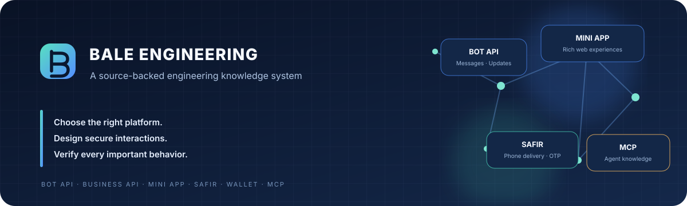
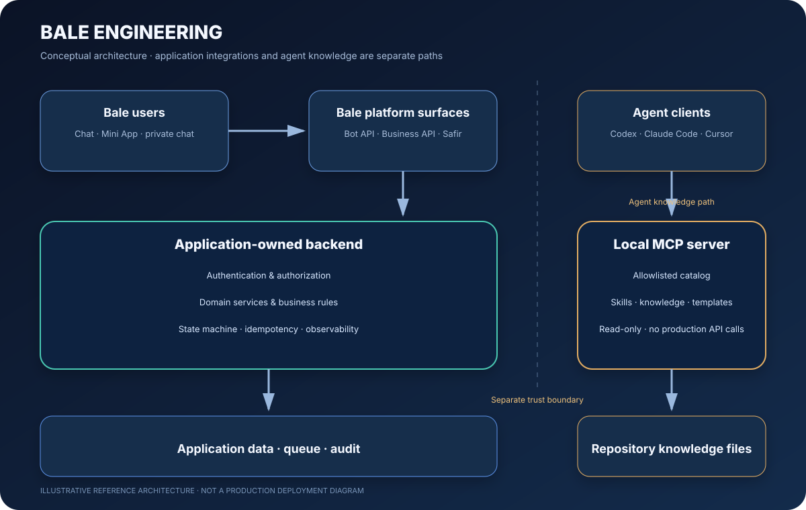

# Bale Engineering

<a href="README.fa.md">نسخه فارسی</a> · <strong>English</strong>

  

<h1 align="center">Bale Engineering</h1>

<strong>A source-backed engineering knowledge system for building reliable software on Bale.</strong>

  

Bale Engineering is more than an API notes repository. It helps developers and coding agents choose the correct Bale surface, design secure interactions, understand provider constraints, and verify implementations with explicit evidence.

  <a href="README.fa.md">فارسی</a> ·
  <a href="docs/architecture.md">Architecture</a> ·
  <a href="packages/mcp-server/README.md">MCP Server</a> ·
  <a href="adapters/README.md">Agent setup</a> · <a href="CONTRIBUTING.md">Contributing</a>

## At a glance

| Component | Purpose |
|---|---|
| Skills | Focused engineering workflows for coding agents |
| Knowledge | Source-backed API facts, constraints, examples and failure modes |
| MCP server | Local, read-only access to the canonical knowledge |
| Templates | PRD, ADR, API contract and test matrix |
| Diagrams and visuals | Editable Mermaid sources and bilingual SVG illustrations |

## Why this project exists

1. **Bale is not Telegram.** Bale's Bot API is based on Telegram's API, but compatibility must never be assumed method by method.
2. **Choose the correct surface.** Bot API, Business API, Mini App and Safir have different recipients, identities, quotas and security boundaries.
3. **Separate facts from recommendations.** Platform-documented behavior, engineering recommendations and unknown behavior are labelled distinctly.
4. **Design for failure.** Authorization, idempotency, retries, reconciliation, observability and tests are part of the design.
5. **One source of truth.** Agent skills and MCP resources read the same canonical files.
6. **Safe by default.** The MCP server is read-only and does not call Bale, Safir or production systems.

## Supported platform surfaces

| Surface | Use it for |
|---|---|
| Bot API | Bot conversations, messages, updates, keyboards, callbacks and chat workflows |
| Business API | Outbound notifications to existing private Bale chats |
| Mini App | Rich forms, dashboards, searchable lists and web workflows inside Bale |
| Safir | Phone-number messaging, OTP and approved templates |
| Wallet payments | Bale wallet invoices, pre-checkout validation and payment confirmation |
| Deep links | Bot, message, invitation, share and Mini App entry points |
| Message formatting | Bale-specific formatting syntax and client limitations |

### Platform selection at a glance

~~~mermaid
flowchart TD
    U[User need] --> D{Interaction type}
    D -->|Chat and callbacks| BOT[Bot API]
    D -->|Rich forms and dashboards| MINI[Mini App]
    D -->|Existing private chat notification| BIZ[Business API]
    D -->|Phone number and OTP| SAFIR[Safir]
    D -->|Wallet checkout| PAY[Bot API or Mini App invoice]
    BOT --> CORE[Application-owned backend]
    MINI --> CORE
    BIZ --> CORE
    SAFIR --> CORE
    PAY --> CORE
    CORE --> DB[(Application state and audit)]
~~~

The application backend owns business rules, authorization, durable state and idempotency. Bale channels are adapters, not the source of truth for business completion.

## Install the main skill

Requirements depend on the target agent and Skills CLI version. For supported agents:

~~~bash
npx skills add shahinesi/Bale-Engineering --skill bale-engineering
~~~

Focused skills can be installed independently:

~~~bash
npx skills add shahinesi/Bale-Engineering --skill bale-bot-api
npx skills add shahinesi/Bale-Engineering --skill bale-business-api
npx skills add shahinesi/Bale-Engineering --skill bale-miniapp
npx skills add shahinesi/Bale-Engineering --skill bale-safir
npx skills add shahinesi/Bale-Engineering --skill bale-wallet-payments
~~~

See [Agent adapters](adapters/README.md) for Codex, Claude Code, Cursor and other setup guidance.

## Run the MCP server locally

Requirements: Node.js 20 or newer and pnpm.

~~~bash
pnpm install
pnpm --filter @bale-engineering/mcp-server build
node packages/mcp-server/dist/index.js
~~~

The foundation release uses **stdio** for local MCP clients. It exposes read-only knowledge, deterministic keyword routing and local validators. Remote Streamable HTTP, hosted deployment and production API access are deliberately out of scope.

See [MCP server setup](packages/mcp-server/README.md).

## MCP capabilities

### Prompts
- `bale-engineering` — start a task with platform selection, security, failure handling and verification.
- `bale-engineering-review` — review a Bale implementation against the canonical quality checklist.

### Resources
- `bale://catalog`
- `bale://skills/{id}`
- `bale://knowledge/{id}`
- `bale://sources`

### Tools
- `bale_list_skills`
- `bale_get_skill`
- `bale_get_reference`
- `bale_search_knowledge`
- `bale_route_task`
- `bale_validate_inline_keyboard`
- `bale_validate_safir_payload`
- `bale_validate_business_api_request`

The keyword router is a deterministic first-pass hint, not semantic reasoning. Validators check local payload shape; they do not prove that a live provider will accept a request.

## Documentation and diagrams

The documentation is maintained in Persian and English. Mermaid source files are editable text and are rendered by GitHub in Markdown and supported diagram files. SVGs provide crisp, accessible visual summaries and are presentation assets rather than the source of truth.

- [English architecture guide](docs/architecture.md)
- [راهنمای معماری فارسی](docs/architecture.fa.md)
- [Documentation index](docs/README.md)
- [فهرست مستندات فارسی](docs/README.fa.md)

| Diagram | English | فارسی |
|---|---|---|
| Platform selection | [MMD](docs/diagrams/platform-selection.mmd) | [MMD](docs/diagrams/platform-selection.fa.mmd) |
| Bot update lifecycle | [MMD](docs/diagrams/bot-update-lifecycle.mmd) | [MMD](docs/diagrams/bot-update-lifecycle.fa.mmd) |
| Mini App authentication | [MMD](docs/diagrams/miniapp-authentication.mmd) | [MMD](docs/diagrams/miniapp-authentication.fa.mmd) |
| Wallet payment lifecycle | [MMD](docs/diagrams/wallet-payment-lifecycle.mmd) | [MMD](docs/diagrams/wallet-payment-lifecycle.fa.mmd) |
| MCP architecture | [MMD](docs/diagrams/mcp-architecture.mmd) | [MMD](docs/diagrams/mcp-architecture.fa.mmd) |
| Business API notification | [MMD](docs/diagrams/business-api-notification.mmd) | [MMD](docs/diagrams/business-api-notification.fa.mmd) |
| Safir delivery | [MMD](docs/diagrams/safir-delivery-lifecycle.mmd) | [MMD](docs/diagrams/safir-delivery-lifecycle.fa.mmd) |
| Callback authorization | [MMD](docs/diagrams/callback-authorization.mmd) | [MMD](docs/diagrams/callback-authorization.fa.mmd) |
| Deep-link entry points | [MMD](docs/diagrams/deep-link-entrypoints.mmd) | [MMD](docs/diagrams/deep-link-entrypoints.fa.mmd) |

## Repository layout

~~~text
skills/                  Canonical agent skills
knowledge/               Source-backed Bale references
packages/mcp-server/     Local read-only MCP server
templates/               Reusable engineering artifacts
adapters/                Agent installation guidance
docs/                    Bilingual architecture and Mermaid diagrams
assets/                  Brand mark and README artwork
sources.json             Official sources and engineering references
AGENTS.md                Contributor and coding-agent rules
~~~

## Security boundaries

- The MCP server does not send messages, modify bots or call Bale/Safir APIs.
- Never place bot tokens, Safir API keys, OTPs or production secrets in code, prompts, logs or MCP arguments.
- Verify raw Mini App `initData` on the backend before trusting identity.
- Callback payloads and disabled buttons are not authorization.
- A pre-checkout event is not proof of payment; fulfil only after validating the successful-payment event.
- Architecture illustrations are conceptual references, not screenshots or claims about a live production deployment.

## Project status

**Foundation release — v0.1.0.** The repository includes canonical skills, source-backed references, a local read-only MCP server, bilingual architecture guides, Mermaid sources and SVG visuals. The npm package is not published. Remote MCP hosting and live Bale API integrations are not part of this release.

## Sources and attribution

Platform behavior is grounded in the [official Bale documentation](https://docs.bale.ai/). See [sources.json](sources.json) and the source links in each knowledge reference.

Visual documentation follows the official [GitHub Mermaid rendering guide](https://docs.github.com/en/get-started/writing-on-github/working-with-advanced-formatting/creating-diagrams) and [Mermaid syntax reference](https://mermaid.js.org/intro/syntax-reference).

The engineering structure takes inspiration from [Ponytail](https://github.com/DietrichGebert/ponytail) and [Product Engineering](https://github.com/phuryn/product-engineering). No skill content or implementation is copied from those projects.

## License

MIT. See [LICENSE](LICENSE). Bale's names, APIs and official documentation remain the property of their respective owners.
