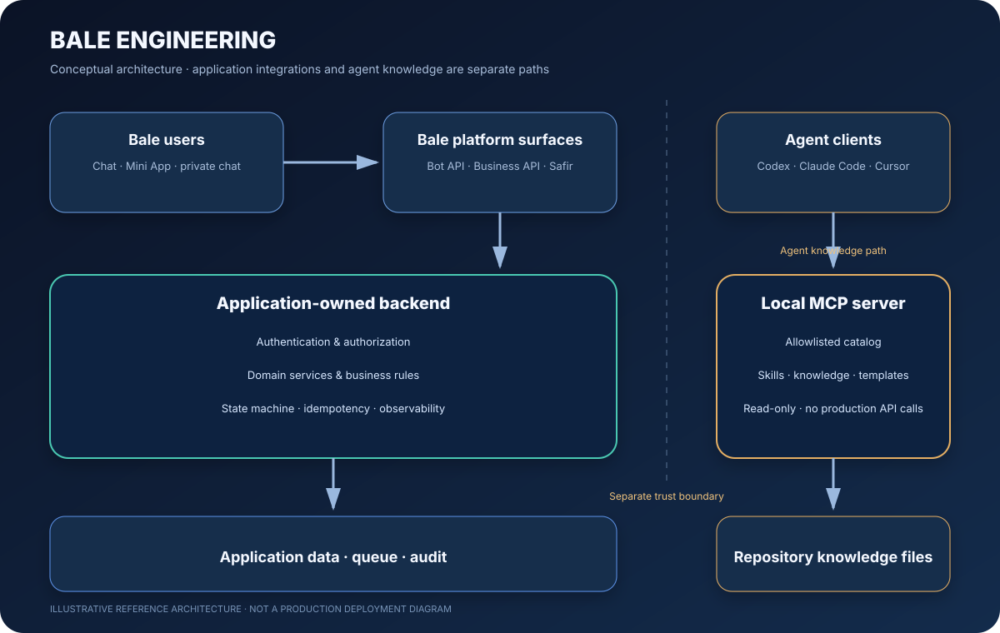

# Bale Engineering Architecture

[فارسی](architecture.fa.md) · **English**

This page describes the conceptual architecture of the Bale Engineering knowledge system. It is not a deployment diagram for Bale infrastructure or a production bot.

## 1. Two separate paths

Bale Engineering has two deliberately separate paths:

1. **Application engineering path:** a developer uses the skills and references to build an application that integrates with Bale.
2. **Agent knowledge path:** an MCP-compatible agent reads the same repository knowledge through a local, read-only MCP server.

The MCP server does not call Bale, Safir, production APIs, customer databases or application backends.

## 2. Platform surfaces

~~~mermaid
flowchart TD
    U[User need] --> D{Interaction type}
    D -->|Chat and callbacks| BOT[Bot API]
    D -->|Rich forms and dashboards| MINI[Mini App]
    D -->|Notification to an existing private chat| BIZ[Business API]
    D -->|Phone number and OTP| SAFIR[Safir]
    D -->|Wallet payment| PAY[Bot API invoice or Mini App invoice]
    BOT --> CORE[Application-owned backend]
    MINI --> CORE
    BIZ --> CORE
    SAFIR --> CORE
    PAY --> CORE
    CORE --> STATE[(Application state and audit)]
~~~

The backend should own business rules, authorization, durable state and idempotency. Bale channels are adapters, not the source of truth for business completion.

## 3. Bot update processing

~~~mermaid
sequenceDiagram
    participant B as Bale
    participant I as Webhook or Poller
    participant Q as Durable Queue
    participant H as Update Handler
    participant D as Domain Service
    participant DB as Application DB

    B->>I: Update
    I->>H: Validate envelope and deduplicate update_id
    H->>Q: Persist work item
    Q->>H: Deliver work
    H->>D: Execute authorized use case
    D->>DB: Commit state and audit
    DB-->>H: Commit result
    H-->>B: answerCallbackQuery when applicable
~~~

For polling, persist the update outcome before advancing the offset. For webhooks, make duplicate deliveries harmless. Do not assume every Update contains a normal message.

## 4. Mini App identity boundary

~~~mermaid
sequenceDiagram
    participant U as User
    participant C as Bale Client
    participant W as Mini App
    participant A as Application Backend

    U->>C: Open Mini App
    C->>W: Supply raw initData
    W->>A: Send raw initData over HTTPS
    A->>A: Validate HMAC and auth_date
    alt Valid and fresh
        A-->>W: Authenticated application session
        W->>A: Authorized API request
    else Invalid or expired
        A-->>W: Reject authentication
    end
~~~

Do not trust <code>initDataUnsafe</code>, a client-provided user ID or a contact-sharing UI event as proof of identity. Verify raw <code>initData</code> on the backend according to Bale's documented procedure.

## 5. Wallet payment lifecycle

~~~mermaid
stateDiagram-v2
    [*] --> PendingOrder
    PendingOrder --> InvoiceCreated: Create invoice
    InvoiceCreated --> PreCheckout: User starts checkout
    PreCheckout --> Rejected: Invalid order or amount
    PreCheckout --> AwaitingPayment: answerPreCheckoutQuery(ok)
    AwaitingPayment --> Paid: SuccessfulPayment validated
    AwaitingPayment --> Expired: Provider or order expiry
    Paid --> Fulfilled: Idempotent fulfilment
    Rejected --> [*]
    Expired --> [*]
    Fulfilled --> [*]
~~~

A pre-checkout event is not proof of payment. Confirm the successful-payment update and process the provider payment identifier idempotently before fulfilment.

## 6. MCP knowledge path

~~~mermaid
flowchart LR
    AGENT[Codex / Claude Code / Cursor] <-->|MCP over STDIO| SERVER[Local MCP Server]
    SERVER --> CATALOG[Allowlisted Catalog]
    CATALOG --> SKILLS[Skills]
    CATALOG --> KNOWLEDGE[Knowledge References]
    CATALOG --> TEMPLATES[Engineering Templates]
    SERVER -.->|No production access| DENY[No Bale API / no database / no message sending]
~~~

The catalog is explicit and local. Tools are deterministic: keyword search and validators are not semantic reasoning and do not prove that a live provider will accept a request.

## 7. Repository ownership

| Layer | Responsibility |
|---|---|
| <code>skills/</code> | Agent workflows, decisions and engineering guardrails |
| <code>knowledge/</code> | Source-backed platform facts and implementation references |
| <code>packages/mcp-server/</code> | Read-only MCP tools, prompts and resources |
| <code>templates/</code> | Repeatable engineering artifacts |
| <code>docs/diagrams/</code> | Editable Mermaid sources |
| <code>docs/images/</code> | SVG architecture illustrations |
| <code>assets/brand/</code> | Project identity and README artwork |

## 8. Design rules

- Keep domain logic in the application backend.
- Keep delivery status separate from business completion.
- Verify identity and authorization on the server.
- Make retried external operations idempotent.
- Treat provider timeouts as unknown outcomes until reconciled.
- Distinguish documented provider behavior from engineering recommendations.
- Update English and Persian docs together.
- Keep diagrams as text source; SVGs are presentation assets and should not become the only source of truth.

## 9. Editable diagram sources

- [Platform selection](diagrams/platform-selection.mmd)
- [Bot update lifecycle](diagrams/bot-update-lifecycle.mmd)
- [Mini App authentication](diagrams/miniapp-authentication.mmd)
- [Wallet payment lifecycle](diagrams/wallet-payment-lifecycle.mmd)
- [MCP architecture](diagrams/mcp-architecture.mmd)
- [Business API notification](diagrams/business-api-notification.mmd)
- [Safir delivery lifecycle](diagrams/safir-delivery-lifecycle.mmd)
- [Callback authorization](diagrams/callback-authorization.mmd)
- [Deep-link entry points](diagrams/deep-link-entrypoints.mmd)

Persian source files use the <code>.fa.mmd</code> suffix.

## 10. Official references

- [Bale documentation](https://docs.bale.ai/)
- [GitHub: creating diagrams with Mermaid](https://docs.github.com/en/get-started/writing-on-github/working-with-advanced-formatting/creating-diagrams)
- [Mermaid syntax reference](https://mermaid.js.org/intro/syntax-reference)
- [Mermaid sequence diagrams](https://mermaid.js.org/syntax/sequenceDiagram)
- [Mermaid state diagrams](https://mermaid.js.org/syntax/stateDiagram)
